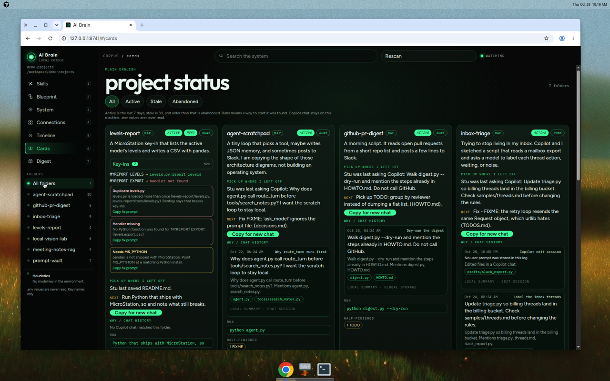
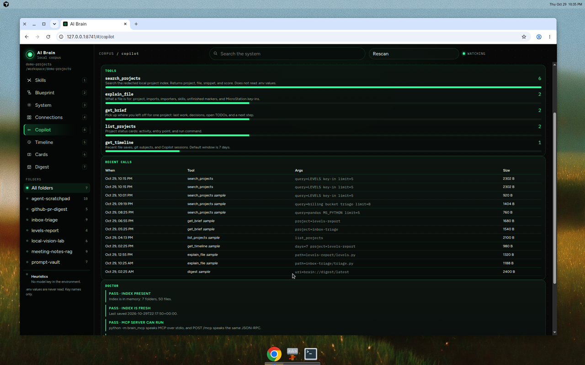

# AI Brain

A local mission-control view of a messy folder of AI and coding projects: markdown notes, Python scripts, configs, and half-finished Copilot experiments. It scans the folder on your machine, then draws how the work connects.

Eight views:

- **Skills** — radial map of capabilities detected in the files
- **Blueprint** — flowchart of each folder (and of the whole corpus), with an ask bar. This is the map.
- **System** — circular meters, one bar per file
- **Connections** — services and APIs the files mention, and whether a key *name* is present
- **Copilot** — MCP tools Copilot agent mode can call, plus a doctor (press `8`)
- **Timeline** — “what was I doing?”, grouped by day and week across every scanned folder
- **Cards** — one plain-English status card per folder
- **Digest** — today or this week across every folder

Nothing is uploaded. The app binds to `127.0.0.1`.

## Windows — one command

Install [Python 3.11+](https://www.python.org/downloads/) (check “Add python.exe to PATH”) and [Node.js 20+](https://nodejs.org/). Node is only required the first time, to build the UI.

Downloaded `start.ps1` files are blocked by the default execution policy. Use `start.bat` or `start.cmd` instead. Both call PowerShell with `-ExecutionPolicy Bypass` and pass arguments through:

```bat
start.bat
start.bat -Projects "C:\Users\me\Documents" -Port 8742
```

`start.cmd` is the same wrapper. Double-click either one to open the demo.

The page is served as soon as the process is listening. A large folder (Documents, a OneDrive tree) keeps scanning in the background, and the sidebar shows that path plus live progress. You do not have to wait on “Waiting for application startup”.

If port 8741 is already taken by a previous AI Brain, the script asks whether to stop that process or pick the next free port, then prints the URL it will actually open. It will not kill an unrelated program. `-Replace` stops the old AI Brain without asking. `-Port` chooses the first port to try.

```bat
start.bat -Projects "D:\notes\ai-projects" -Port 8750 -Replace
```

Calling the script directly still works after you allow it:

```powershell
powershell -NoProfile -ExecutionPolicy Bypass -File .\start.ps1 -Projects "D:\notes\ai-projects" -Port 8741
```

macOS and Linux: `./start.sh` or `PORT=8742 ./start.sh /path/to/projects`. A busy port moves to the next free one.

Each immediate subfolder is treated as one project. A folder with no subfolders is one project. The scanner skips `.git`, `node_modules`, virtualenvs, build output, OneDrive cache folders (not your OneDrive itself), Office and other binary files, and cloud-only placeholders that would hang on read. Each project contributes at most 250 files, and a scan stops at 2000 files.

## Model keys (optional)

With no keys, summaries and answers come from heuristics: docstrings, note intros, imports, and a skill catalog. That mode is what the demo uses.

To let a model rewrite folder summaries and answer the ask bar, set one of these before starting:

| Provider | Environment |
| --- | --- |
| OpenAI | `OPENAI_API_KEY` |
| Anthropic | `ANTHROPIC_API_KEY` |
| Grok / xAI | `XAI_API_KEY` or `GROK_API_KEY` |
| Ollama | `OLLAMA_HOST` (for example `http://127.0.0.1:11434`) |

Force a provider with `LLM_PROVIDER=openai|anthropic|grok|ollama`. Override the model with `LLM_MODEL`.

If several keys are set and `LLM_PROVIDER` is empty, the app prefers Ollama when `OLLAMA_HOST` is set, then OpenAI, Anthropic, and Grok.

PowerShell:

```powershell
$env:OPENAI_API_KEY = "sk-..."
$env:LLM_MODEL = "gpt-4o-mini"
.\start.bat -Projects "D:\notes\ai-projects"
```

The key stays in the environment. The UI shows the provider name and model id, never the key.

## What it refuses to read

`.env`, `.env.local`, and similar files are parsed for **key names only**. The characters after `=` are discarded and are not stored, shown, or sent to a model. `.env.example` counts as a template, not as a connected key.

Secret-shaped strings in scripts and notes (`sk-…`, `ghp_…`, Slack webhook URLs, `KEY=value` lines) are redacted before they enter the index.

## Timeline

Open **Timeline** (or press `5`). It answers “what was I doing?” for the whole scan.

Filters are **Today**, **7 days**, and **30 days**. Each day lists the folders that changed, the files in them, and a one-line summary. Save times come from file modification times. If a folder is its own git repository (it contains `.git`), commit subjects from `git log` are included too. A parent repo that merely contains the folder is not used. Click the folder name to focus it on the Blueprint map.

`GET /api/timeline?days=1|7|30` returns that payload. With no model key the summaries are heuristics (which files changed, and the commit subject when there is one). When a provider key is set, the same provider used for folder summaries rewrites those lines. The call is cached. `.env` values are never included.

## Project cards

Open **Cards** (or press `6`). One card per folder:

- one or two sentences on what it is, from the README (or the model, once a summary has been written)
- **Active** if something was touched in the last 7 days, **Stale** within 30, **Abandoned** after that
- **Runs** when a way to start it was found, otherwise **Unknown**
- the entry point and the command: `main.py` / `app.py`, `package.json` scripts, a `run` script, or a command written in the README or HOWTO
- what looks half-finished: TODO and FIXME counts, stub or scratch files, empty files, and third-party imports that are not listed in requirements
- last touched date, file count, and language counts

`GET /api/cards` returns the grid. Heuristics work with no API key. A configured provider can replace the blurb; it does not read `.env` values.

Each card, and the folder detail on the map, also has **Pick up where I left off**. That brief says what Stu was last doing, lists recent decisions and open TODOs, and suggests a next step. It is built from the latest save, git commit subjects when the folder is its own repo, TODO and FIXME markers, and the latest Copilot prompts. **Copy for new chat** puts a ready-to-paste block on the clipboard: the brief, the key files, and the run command. **Save BRAIN_HANDOFF.md** writes that block into the project folder, and only when that button is clicked.

`GET /api/briefs` returns every brief. `GET /api/brief/{project}` returns one. `POST /api/brief/{project}/handoff` writes `BRAIN_HANDOFF.md`. With no model key the sentences are local. Set `BRAIN_BRIEF_LLM=1` as well as a provider key to let the model rewrite them. Chat text is not sent otherwise. `.env` values are never included.

## MicroStation Python

A folder is treated as MicroStation Python when a script imports an `MSPy*` module (`MSPyBentley`, `MSPyDgnPlatform`, `MSPyMstnPlatform`, and the rest) or the folder contains a `*.commands.xml` key-in table. No API key is required.

The card shows an **MSPy** badge, the key-in strings, and the handler each one calls (`levels.py:report_levels`). A handler that is not defined in the scanned scripts is marked missing. Pitfall chips follow [Bentley's Python guide](https://developer.bentley.com/documentation/microstation-python-api/guides/developingpythonapps.md):

- the same `.py` filename loaded in more than one MicroStation script (key-ins stop working)
- a third-party import such as `pandas`, which needs `MS_PYTHON` pointed at a matching Python install, not a virtualenv
- a key-in whose handler function was not found
- a `commands.xml` with no matching `.py`

Each chip copies a short Copilot prompt that describes the fix. On the Blueprint map, MicroStation folders get a node per key-in linked to the handler function. The ask bar answers “which project has the LEVELS key-in?” from those strings.

`GET /api/microstation` lists every MicroStation project. `GET /api/microstation/{project}` returns one. The same object is on each project card.

The demo folder `demo-projects/levels-report` registers `MYREPORT LEVELS`, imports pandas, and includes a second `levels.py` so the duplicate-filename warning is visible.



## Copilot Link

GitHub Copilot agent mode can query the indexed folders through an MCP server instead of grepping the tree. The tools are read-only, local, and work with no API key. They use the SQLite scan cache. They do not start a scan. If a scan is already running, they answer from the last finished index and say so.

Open **Copilot** (or press `8`). The status light shows whether VS Code has registered the server and when it was last called. Each tool has a call count. **Run doctor** checks the index, the Python path, the extension version, and registration. **Copy mcp.json snippet** copies a stdio config that uses the same Python interpreter the running server was started with.

Tools:

- `search_projects` — same retrieval as the ask bar in heuristic mode
- `get_brief` — the pick-up brief for one folder
- `get_timeline` — saves, git subjects, and Copilot sessions
- `explain_file` — imports, skills, unfinished markers, and MicroStation key-ins
- `list_projects` — status, entry point, and run command
- resource `brain://digest/latest` — the latest daily digest markdown

`.env` values are never returned. Every answer is passed through the same redaction as the rest of the app and capped at about 20 KB. Calls are appended to `.brain/mcp_usage.jsonl` under the projects folder (gitignored). `GET /api/mcp/usage` and `GET /api/mcp/doctor` feed the panel. While the dashboard is running, the same JSON-RPC is available at `POST /mcp`.

The VS Code extension registers the server, so a manual `mcp.json` is optional. Install `releases/ai-brain-0.2.0.vsix`, then Copilot agent mode lists **AI Brain**. The extension starts `python -m brain_mcp` with `BRAIN_ROOT` set to the projects folder. It does not run PowerShell.

Manual fallback, from the repo root, if you prefer a file. On Windows, `command` can be `py` and the paths can be `C:\...`:

```json
{
  "servers": {
    "ai-brain": {
      "type": "stdio",
      "command": "py",
      "args": ["-m", "brain_mcp"],
      "cwd": "C:\\src\\ai-brain-ui",
      "env": {
        "BRAIN_ROOT": "C:\\Users\\Stu\\Documents",
        "BRAIN_CACHE": "C:\\src\\ai-brain-ui\\.brain\\cache.sqlite"
      }
    }
  }
}
```

Put that in `.vscode/mcp.json`. `start.bat` still starts the dashboard. The stdio server only reads the cache that dashboard writes.

Demo mode (the scan folder is named `demo-projects`) shows sample calls so the panel is not empty before Copilot has connected. Set `BRAIN_MCP_DEMO=0` to hide them.



## Copilot chat history

Each project card, and the folder detail on the Blueprint map, has a **Why / Chat history** section. The Timeline lists the same sessions on the day they happened. Prompts that name a scanned file link to that file.

`GET /api/chats` returns the sessions. The reader looks only at GitHub Copilot Chat logs already on disk:

- Windows: `%APPDATA%\Code\User\workspaceStorage\<hash>\` and the same tree for `Code - Insiders` and VSCodium. A hash is matched to a project through `workspace.json` (the `folder` URI, or a `.code-workspace` file).
- Inside each hash: `chatSessions/*.json` and `*.jsonl`, `state.vscdb` keys such as `interactive.sessions` and `memento/interactive-session`, `chatEditingSessions/*/state.json`, and `GitHub.copilot-chat/transcripts`.
- `globalStorage/emptyWindowChatSessions`, transferred sessions, and profile folders are included.
- macOS uses `~/Library/Application Support/Code/User`. Linux uses `~/.config/Code/User` and, when present, `~/.vscode-server/data/User`.

Unreadable or half-written files are skipped. Nothing is uploaded. Chat text is redacted with the same rules as the rest of the index. A model receives chat text only when an API key is already configured **and** `BRAIN_COPILOT_LLM=1`. Otherwise the one-line summary is computed locally from the first prompt and the file names it mentions.

Turn the feature off with `BRAIN_COPILOT_CHATS=0`. Point at one User directory, instead of the usual locations, with `BRAIN_COPILOT_CHATS_ROOT`. Sample logs live in `fixtures/copilot-user/` and are included when the scan folder is named `demo-projects`, so the demo shows them. Set `BRAIN_COPILOT_INCLUDE_SAMPLES=0` to hide those samples, or `=1` to include them on a real projects folder.

```bat
set BRAIN_COPILOT_CHATS=0
start.bat
```

```bat
set BRAIN_COPILOT_CHATS_ROOT=%APPDATA%\Code\User
set BRAIN_COPILOT_LLM=1
start.bat -Projects "D:\notes\ai-projects"
```

## Digest

Open **Digest** (or press `7`). Choose **Today** or **This week**.

The page lists folders whose files were saved in the window, folders that slipped from active to stale (last save crossed 7 days) or on to abandoned (30 days), the open TODO and FIXME count with the top items, notable Copilot sessions, and a short suggested focus list.

`GET /api/digest?period=day|week` returns that payload. **Export markdown** writes it to `.brain/digests/` under the projects folder (gitignored) and downloads the same file. The server does not write a digest on its own unless you set `BRAIN_DIGEST=daily` or `BRAIN_DIGEST=weekly` before starting. That writes one markdown file per day or ISO week while the process is running, and skips the file if it is already there.

```bat
set BRAIN_DIGEST=weekly
start.bat -Projects "D:\notes\ai-projects"
```

A model rewrites the digest intro only when a provider key is set and `BRAIN_DIGEST_LLM=1`. The default is the local summary. `.env` values are never read.

In VS Code, **AI Brain: Open Digest** opens the same page inside the dashboard webview. The Digest tab is also on the dashboard the activity-bar icon already loads.

## VS Code panel

`vscode-extension/` is a small extension that opens this dashboard as a webview. A built package is committed at `releases/ai-brain-0.2.0.vsix`.

1. In VS Code, open Extensions.
2. Open the `...` menu and choose **Extensions: Install from VSIX...**.
3. Select `releases/ai-brain-0.2.0.vsix`.
4. Use the activity-bar **AI Brain** icon, or run **AI Brain: Open Dashboard** from the command palette.

The panel loads `http://127.0.0.1:8741/`. The port is the `aiBrain.port` setting. If that server is not running, the extension asks, then starts it with `python -m uvicorn backend.app.main:app --host 127.0.0.1 --port 8741`. It does not run PowerShell. On Windows it tries `py`, then `python`, then `python3`.

The projects folder is the workspace you have open, or `aiBrain.projectsFolder` when that is set. The Python checkout is discovered by walking the workspace for `backend/app/main.py`. The VSIX does not contain the backend, so set `aiBrain.repoPath` when the open folder is not this repo. `aiBrain.pythonPath` overrides the Python executable.

Rebuild the package from the repo:

```bash
cd vscode-extension
npm install
npm run compile
npx vsce package --allow-missing-repository -o ../releases/ai-brain-0.2.0.vsix
```

## How a scan becomes the views

The scanner walks each project, reads text files, and builds:

- a skill tag from a small catalog (OpenAI, RAG, Slack, routing, MicroStation Python, lab notes, …)
- an architecture graph from entry points, local imports, and functions that branch (`classify`, `route`, `bucket`, …)
- a service card when code or a key name mentions OpenAI, GitHub, Slack, Ollama, and the rest of the catalog
- a plain-English folder summary from the README plus those facts

The server starts listening before that walk finishes. The sidebar shows the projects folder you pointed at, and the main panel shows which folder and file are being read. A file watcher refreshes the dashboard about a second after you save. Results are cached in `.brain/cache.sqlite` (gitignored) so the next start is instant when nothing changed.

The ask bar retrieves matching files from that index. With a model configured, those excerpts are the only context sent — the same redacted text the UI can show.

Ideas borrowed, not vendored: [Graphify](https://github.com/Graphify-Labs/graphify) for a knowledge graph of a repo, Understand-Anything for plain-English explanations, [Repomix](https://github.com/yamadashy/repomix) for packing the relevant files into one model context, and [GitDiagram](https://github.com/ahmedkhaleel2004/gitdiagram) for drawing architecture from structure and imports. This app aims that at loose script folders rather than a single production repo.

## Develop

```bash
python3 -m venv .venv
.venv/bin/pip install -r requirements.txt
.venv/bin/python -m pytest
cd frontend && npm install && npm run build
BRAIN_ROOT=./demo-projects .venv/bin/python -m uvicorn backend.app.main:app --host 127.0.0.1 --port 8741
```

`npm run dev` in `frontend` serves the UI on port 8742 and proxies `/api` to 8741.

## Demo folder

`demo-projects/` is a fake week of VS Code work: an inbox labeler, a meeting-note search, a pull-request digest, a prompt vault, a local photo sorter, and a tiny agent loop. The `.env` files contain obvious placeholder values so the connections view can show “connected” without a real credential. Those placeholders are the only `.env` files tracked in git. Timeline and Cards use the same scan: the inbox and the agent have run commands, the photo sorter is missing Pillow, the notes search imports Chroma without listing it, and the prompt vault has no entry point.

`fixtures/copilot-user/` is a fake VS Code user directory (chat session logs, a transcript, a `state.vscdb`, and an edit session) so those cards show Why / Chat history without a real Copilot profile. One sample line contains a fake `sk-` token; the API redacts it.
